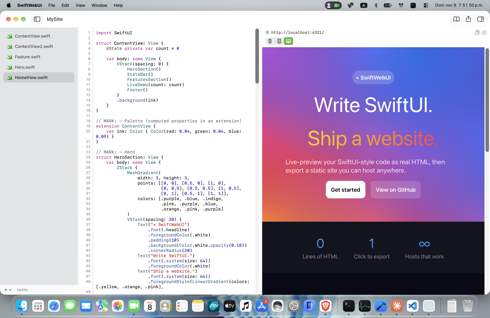

# SwiftWebUI

A native macOS app for web developers. Write SwiftUI-style code, watch it render as a real web page as you type, then export a static website you can host anywhere.


[**SwiftWebUI example Swift source code**](marketing/example.swift)

## How it works

SwiftWebUI **interprets** your code instead of compiling it:

1. Your Swift source is parsed with [SwiftSyntax](https://github.com/swiftlang/swift-syntax).
2. The syntax tree is converted into a view tree.
3. The view tree is rendered to HTML/CSS (plus a tiny runtime for `@State`).
4. The result is shown in a `WKWebView` and updates live as you edit.

Only a defined subset of Swift is supported. Anything outside it produces a clear, line-specific error rather than being silently ignored. The view tree is the boundary between parsing and output, so the renderer can be replaced later.

## Features

- Three-pane window: file sidebar, code editor, live preview
- Code editor with syntax highlighting, line numbers, auto-indent, autosave and per-file undo
- Live preview that updates as you type
- Built-in reference of supported views and modifiers, with insertable examples
- Project templates and a recent-projects list
- Static site export (HTML/CSS/JS plus referenced images), no server required

## Supported SwiftUI subset

| Category | Supported |
|---|---|
| Layout | `VStack`, `HStack`, `ZStack`, `Spacer`, `List`, `ScrollView`, `ForEach` |
| Content | `Text`, `Image`, `Button`, `Link`, `Color` |
| Gradients | `LinearGradient`, `RadialGradient`, `AngularGradient`, `EllipticalGradient`, `MeshGradient` |
| Modifiers | `padding`, `font`, `foregroundColor`, `foregroundStyle`, `background`, `frame`, `cornerRadius` |
| Composition | Custom `View` structs, including across files; computed properties in extensions |
| State | `@State` values mutated by `Button` actions |

The in-app Reference lists every argument each view and modifier accepts. A full example lives in [marketing/example.swift](marketing/example.swift).

```swift
struct ContentView: View {
    var body: some View {
        VStack(spacing: 16) {
            Text("Hello, web")
                .font(.largeTitle)
            Link("Read more", destination: "https://example.com")
        }
        .padding(32)
    }
}
```

## Project format

A project is a normal folder with a `swiftwebui.json` manifest and a sources folder:

```json
{
  "name": "My Site",
  "sources": "Sources",
  "entryView": "ContentView"
}
```

`entryView` names the `View` struct that is rendered as the page.

## Requirements

- macOS 14 or later
- Xcode 27.1 / Swift 6.4 (to build from source)

## Building

```bash
git clone <repo-url>
cd SwiftWebUI/SwiftWebUIApp
open SwiftWebUI.xcodeproj
```

Then run the `SwiftWebUI` scheme. The app is sandboxed.

From the command line:

```bash
cd SwiftWebUIApp
xcodebuild -project SwiftWebUI.xcodeproj -scheme SwiftWebUI build
```

## Tests

The core logic lives in a local Swift package that does not depend on SwiftUI or AppKit, so it can be tested on its own:

```bash
cd SwiftWebUIApp/Packages/SwiftWebUICore
swift test
```

## Repository layout

```
SwiftWebUIApp/
  SwiftWebUI/                  macOS app target (SwiftUI + AppKit)
  SwiftWebUI.xcodeproj
  Packages/SwiftWebUICore/     parser, renderer, project model, export, editor logic
    Sources/SwiftWebUICore/
      Parser/                  SwiftSyntax -> view tree, registry, diagnostics
      Renderer/                view tree -> HTML/CSS, gradients, runtime
      Editor/                  syntax highlighting, indentation, open-file sessions
    Tests/SwiftWebUICoreTests/
marketing/                     example project and screenshot
docs/                          MVP1 plan and release notes (local, not tracked)
```

## Releasing

Distribution outside the Mac App Store needs a Developer ID certificate and notarization. See `docs/release.md` for the steps.

## Status

MVP1, in development. Not yet supported: multiple pages and routing, packages, Git integration, autocomplete, and arbitrary Swift logic.
